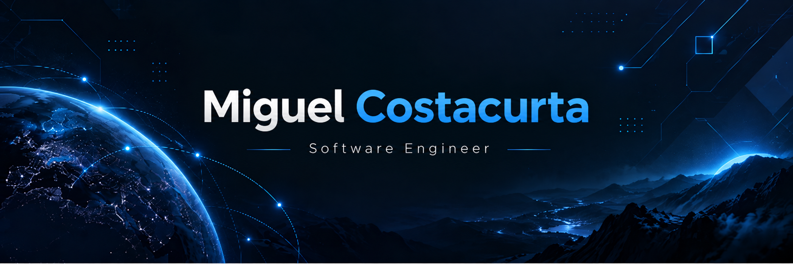

  

  &nbsp;&nbsp;
  &nbsp;&nbsp;
  

 

 

<h2 align="center">
  
</h2>

  <table>
    <tr>
      <td width="50%" valign="top">
        <h3 align="center"><a href="https://github.com/MikeOSS/RouteX">RouteX</a></h3>
        
<strong>Gestão & Otimização Logística de Rotas</strong>

        
Sistema desenvolvido para otimização e roteirização inteligente de trajetos operacionais, reduzindo custos em 15% na DVI Radiologia através de algoritmos de cálculo de rotas e integração com APIs de mapas.

        

        
<code>Python</code> <code>Otimização</code> <code>Geolocalização</code> <code>APIs</code> <code>Algoritmos</code>

      </td>
      <td width="50%" valign="top">
        <h3 align="center"><a href="https://github.com/MikeOSS/Site-Safe-Vision">Safe Vision</a></h3>
        
<strong>Monitoramento & Visão Computacional para Segurança</strong>

        
Sistema de segurança e monitoramento baseado em visão computacional e inteligência artificial para detecção e acompanhamento de cenários de risco em tempo real. Reconhecido em mostras tecnológicas e de inovação.

        

        
<code>Computer Vision</code> <code>Python</code> <code>OpenCV</code> <code>IA</code> <code>Segurança</code>

      </td>
    </tr>
    <tr>
      <td width="50%" valign="top">
        <h3 align="center"><a href="https://github.com/MikeOSS/empresaFicticiaAutomacao">AltaCLP &middot; Alert Intelligence</a></h3>
        
<strong>Triagem Inteligente de Alertas Industriais com LLM</strong>

        
Painel operacional e motor inteligente para triagem de alertas industriais. Combina regras determinísticas e LLM (Groq / LLaMA) com Firebase Cloud Functions e Firestore para bloquear falsos positivos e otimizar despachos técnicos.

        

        
<code>AI / LLM</code> <code>Groq</code> <code>Firebase</code> <code>Cloud Functions</code> <code>Node.js</code> <code>Firestore</code>

      </td>
      <td width="50%" valign="top">
        <h3 align="center"><a href="https://github.com/MikeOSS/PI_II_ES_TIME-23">NotaDez</a></h3>
        
<strong>Sistema Integrado de Gestão Acadêmica</strong>

        
Plataforma robusta para gestão acadêmica desenvolvida no Projeto Integrador PUC-Campinas, contemplando lançamento e auditoria de notas, cálculo automatizado de médias, regras de avaliação e exportação de relatórios.

        

        
<code>Java</code> <code>TypeScript</code> <code>Gestão Acadêmica</code> <code>Auditoria</code> <code>Full Stack</code>

      </td>
    </tr>
  </table>

 

 

<h2 align="center">
  
</h2>

  

  

 

  

  

 

  

  

 

 

<h2 align="center">
  
</h2>

  <table border="0">
    <tr>
      <td align="center" valign="middle">
        
      </td>
      <td align="center" valign="middle">
        
      </td>
    </tr>
    <tr>
      <td align="center" valign="middle" colspan="2">
         
        
      </td>
    </tr>
  </table>

